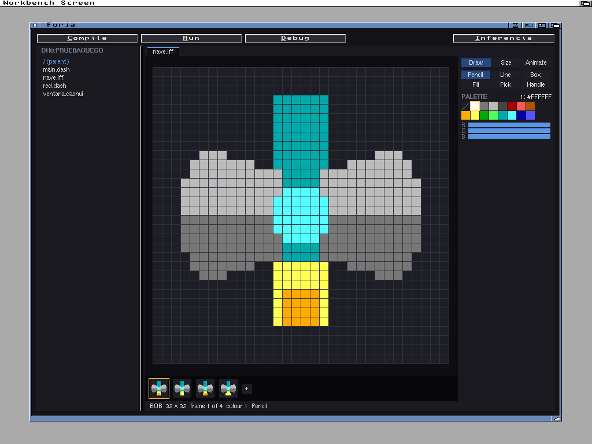
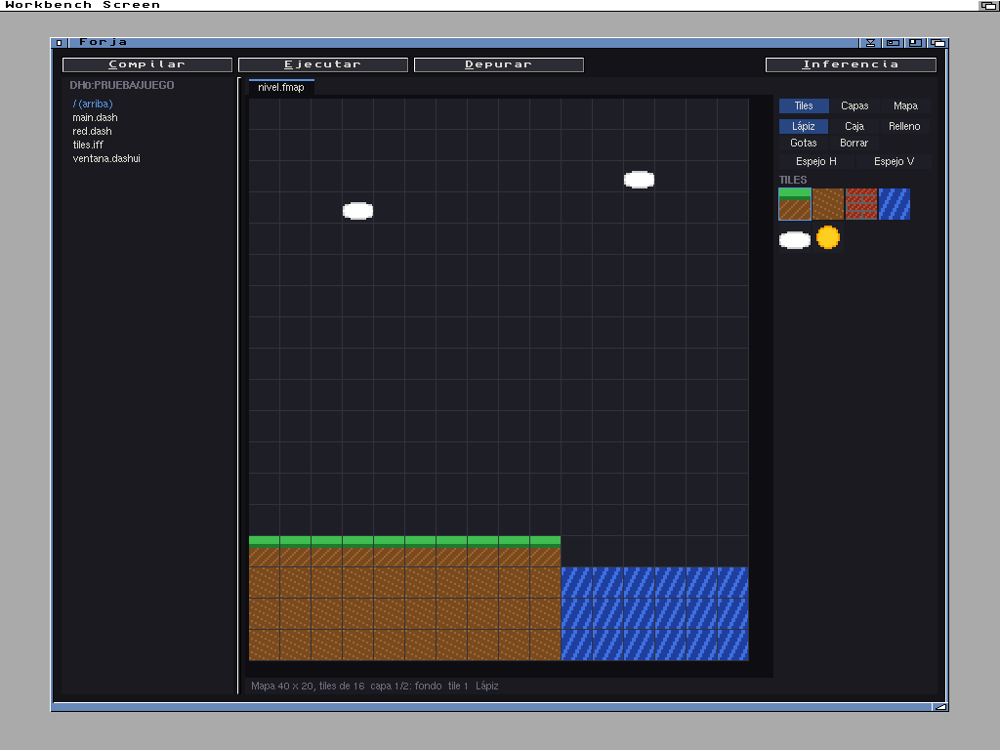

# Forja

*English | [Castellano](README.md)*

Forja is the development environment of [Dash](https://github.com/FreeMEM/FreeMEMLang) for the Amiga itself. This is
Forja 0.7:

- an editor with colours, tabs, bookmarks, folding, find in the project and rename;
- build and run, with the errors marked in the code;
- a step-by-step debugger, with conditions and variables in a tree;
- projects (a `.forja` file) and six templates;
- the whole Dash help, with examples that run;
- a `.dashui` window editor with real MUI;
- extensions: Git, the [Inferencia](https://github.com/FreeMEM/inferencia) copilot, Sprites, Mapas, Demos and Taller3D.

This is a test version: it works in the emulator, but it has not been tried on a real Amiga yet. It speaks
English or Spanish, following the Locale preferences (the English catalog is in `Catalogs/`).

## Requirements

- AmigaOS 3.0 or later, with a 68020 or better, and MUI 3.8 or 5.
- Dash 2.16.0 or later for the Amiga: the `dash-X.Y.Z-amiga.lha` package from
  [Dash](https://github.com/FreeMEM/dash/releases) has the `dash` command and also Forja and dashgit, and its installer sets
  everything up. Forja looks for the compiler in `ENV:Forja/dashc` (in the preferences, with a button to choose it),
  then `DASH:dash`, then as `dash` in the command path.
- For the copilot (the Inferencia extension), [Inferencia](https://github.com/FreeMEM/inferencia) (`ENV:Forja/inferencia`).
- For git (the Git extension), [dashgit](https://github.com/FreeMEM/dashgit) with its `servidor` command: it is looked
  for in `ENV:Forja/dashgit`, then `DASH:dashgit`, then as `dashgit` in the command path. To pull and push over https,
  AmiSSL and a TCP/IP stack.
- Syntax colours look better with more than 4 colours on the screen.

## Use

`Forja [file]`, or double-click its icon. Without a file, it opens what was open last time (this can be turned off
in the preferences): the files with their cursor, bookmarks and folds, the one in front, and the sprites, maps and
tracks the extensions had open.

The preferences can also make Forja start on a screen of its own: a public copy of the Workbench's, named `FORJA`.
While Forja is open it is the default public screen, so the programs it runs open there. On quitting, the old
default comes back. It needs a Dash with `screen_make_default`.

When compiling, the executable goes next to the `.dash`. In the preferences, "Executables in:" picks another drawer
(an idea of Ferrán García), for example `RAM:` (`ENV:Forja/ejecutables`); if it does not exist, Forja creates it. The program runs in the
`.dash`'s drawer, so it finds its files with a relative path (`"jugador.iff"`) even when the executable is elsewhere.
What it looks for in `PROGDIR:` (its icon, its catalogs) it will look for in the executable's drawer.

- **Editor**: the keyboard goes to the editor even with the pointer over the project, the output or the button bar.
  Arrows; with Shift they select; Alt: start and end of line, page up and down; Ctrl: word by word, start and end of
  the text. Tab and Shift+Tab indent; pressing Return after `func`, `if`, `while` and the like indents the new line one
  level and, if the block has no `end` yet, adds it below; `end`, `else` and `elif` go back to their place by
  themselves, as in the VS Code extension. Brackets, braces and quotes close by themselves (typing the closing one
  steps over it; Backspace between the two removes both). Both can be turned off in the Editor menu. Undo (Amiga-Z),
  redo (Amiga-R), cut, copy and paste with the system clipboard.
- **Colours**: those of Dash's grammar (the words come from Dash with `tools/sintaxis.py`, not written by hand), also
  the directives (`@native`...) and the `asm ... end` blocks with their own: instructions, registers and labels.
- **Editor menu** (the default keys; change them in `ENVARC:Forja/teclas`):

  | Command | Key |
  |---|---|
  | Comment or uncomment (the line or the selection; in an asm block, with `;`) | Ctrl / |
  | Duplicate, move up, move down and delete the lines | Ctrl D, Ctrl Alt up, Ctrl Alt down, Ctrl Shift K |
  | Go to the pair (the bracket, or the `end` of a `func`, `if`, `asm`...; with the cursor on one, both are boxed) | Ctrl M |
  | Set or clear bookmark, next, previous | Ctrl F3, F3, Shift F3 |
  | Outline of the file (functions, structs, constants...: filtered by typing) | Ctrl O |
  | Open a file of the project by its name | Ctrl P |
  | Go to a name of the whole project | Ctrl T |
  | Find in the project (the word at the cursor; results to click in the output) | Ctrl Shift F |
  | Replace in the project (the list of changes first) | Ctrl Shift H |
  | Rename in the whole project (the list of changes first) | F2 |
  | Fold or unfold the block at the cursor; unfold all | F4; Shift F4 |
  | Next tab, previous tab and the list of all | Ctrl Tab, Ctrl Shift Tab, Ctrl E |

  F8 is still the next error. `ENVARC:Forja/teclas` has one command per line, `command = keys`: for instance
  `duplicar = alt d` or `comentar = nada`. The commands: comentar, duplicar, subir, bajar, borrar_linea, pareja,
  marcador, marcador_siguiente, marcador_anterior, esquema, abrir_fichero, abrir_simbolo, buscar_proyecto,
  cambiar_proyecto, renombrar, plegar, desplegar_todo, pestana_siguiente, pestana_anterior, pestanas. Letters go by their place on an English keyboard (like those of
  the extensions); a sign (`/`) goes by the character. Whatever is not understood is reported in the output. If the
  file changes while Forja is open, it is read again and the Editor menu shows the new keys.
- **Theme**: `ENVARC:Forja/tema` changes the colours (`comentario = 120 120 136`: fondo, texto, tenue, acento, error,
  seleccion, cursor..., and the syntax ones: clave, tipo, cadena, numero, comentario, llamada, constante, directiva,
  asm_instruccion, asm_registro, asm_etiqueta) and the font of the code (`fuente = xen.font 8`, fixed width).
- **Files**: Amiga-N, Amiga-O, Amiga-S, Amiga-W. The left panel opens the files of the drawer with a click (folders
  first, in order); the wheel and its scroll bar move it. It asks when closing with unsaved changes.
- **Tabs**: one per file. If two files have the same name, their drawer goes in front (`Cueva/main.dash`). Ctrl Tab
  goes to the next one and Ctrl Shift Tab to the previous one. If they do not fit, the one in front is always shown
  and three buttons appear on the right: the arrows move the tabs and the triangle opens the list of all of them. Ctrl
  E opens that list too; typing filters it and Return goes to the chosen one. The wheel over the tabs moves them.
- **Find and replace** (Amiga-F) and **go to line** (Amiga-L). With "Regular expression", the text is a regular
  expression (those of Dash's `regex_find`), and in "Replace with", `$1` to `$9` are its groups. "Find in the project"
  and "Replace in the project" do it in every `.dash` and `.dashui` of the project drawer and the ones inside (with the
  unsaved text of the open ones). Before changing anything, the Changes tab shows each line as it is and as it will
  be. It stays open so you can read it all, also going to other tabs. In it, Return makes the changes and Esc does
  not. If the files change meanwhile, nothing is done and it says so. Open files change in the editor (Amiga-Z undoes
  it); the others, on disk. Rename (F2) works the same way.
- **Completion**: after two letters a list appears under the cursor with Dash's words, its builtins and the
  project's names (functions, structs, constants, global variables and the function's locals; also those of the
  files it imports). After a dot, the struct's fields and methods, or what lists and strings have. Arrows choose,
  Tab or Return insert, Esc closes; Ctrl+Space shows it with fewer letters. Typing "(" after a function or a builtin
  shows its arguments and description. It can be turned off in Preferences. Help or F1 show that help for the name
  under the cursor (idea by Javier R. Santurde "Tolkien").
- **Dash help**: Help or F1 on a function or a word of the language opens its whole page in the help window: the
  signature, the parameters, what it does, an example with colours, "see also" and whether it is in DashOS. A click on
  a link (or a name in the example) goes to its page; Back and Forward (or Backspace, Alt+arrows) go through what you
  saw. "Search:" finds words in the whole help (also by how they start), and Index shows the groups of functions and
  the chapters of the manual. **Try** opens the page's example in a new unnamed tab and runs it. In the Code menu:
  "Dash help" and "Search the help...". The help is the one in the Dash package (`Dash/Ayuda/Dash_en.ayuda`, in Spanish
  `Dash.ayuda`, following Forja's language); it is read in pieces, without loading it all.
- **Errors in the code**: on saving, Forja checks the program with `dash --check` in the background (without slowing
  the editor) and marks the error on its line: the number in red and the text underlined; the output bar says which
  one it is and the output lists it, with a click. After a pause while typing (1.5 s) it also checks the unsaved text
  (Preferences, "Look for errors while typing", turns it off). F8 goes to the next error and Shift+F8 to the previous
  one. Build errors are marked the same way.
- **Go to definition** (Amiga-J or Ctrl+click): to the file and line where the name is defined, opening it if
  needed; Amiga-U goes back. **Find uses** (Amiga-H): the list in the output, and a click goes to each place. The
  symbols are read when a file is opened or shown and after a moment without typing (in the Code menu).
- **The top bar**: Build, Run, Debug and the debugger buttons, each with a coloured icon and its name.
  The ones that do nothing right now are grey, and the one under the pointer lights up. In a narrow window, first
  the grey ones and then all of them show only their icon. On the right, the zones of the extensions (Inferencia,
  the git branch).
- **Build** (Amiga-K) and **run** (Amiga-E): errors show at the bottom, and a click takes you to the line. The
  output keeps everything written to it: the wheel and its scroll bar go back up. A click picks a line (dragging,
  several) and Amiga-C copies it; the Program menu has "Copy the output" and "Save the output...".
  In a project of several files, compiling or running from one without `Main` uses the project's program. A file
  with its own `Main` inside a project (a test, a tool) is built and run by itself. An error
  of the program while it runs is shown in red, and a click goes to its line. **Stop** ends a program stuck in a
  loop (it needs Dash 2.11.0); if it has a window and does not stop, Forja tells you to close it. Quitting with
  something running stops it first.
- **Debug** (Amiga-G or F5): breakpoints with F9 or a click in the margin. They follow their line while typing, and
  undo puts them back on theirs with their condition. F5 continue, F10 step over, F6 step into,
  F7 step out, with the pointer anywhere in the window, unless a text field or another gadget has the keyboard
  (reported by David Martínez). On the left, the call stack and the
  variables, as a tree: a click on the triangle of a list or a struct expands it (one element or field per line,
  indented by level) and another collapses it; what is expanded stays so between steps while the variable exists. A
  list shows 100 elements and "... N more" brings the next ones. The panel scrolls vertically and horizontally with
  its scrollbars, the wheel (with Shift, horizontally) and the arrow keys (with Shift, a page at a time) (idea by
  David Martínez). When it stops, Forja comes to the front: the program's window takes the keyboard when it opens. If the
  stop line is already in view, the code does not move or repaint as a whole, nor jumps when clicking on it or on the variables (reported by
  David Martínez).
- **`.dashui` windows** open in the window designer (Amiga-D switches to text), as in Visual Basic or Delphi (Jose
  asked for it). The window is drawn as MUI would lay it out, with a palette of objects above and their properties
  beside. A click picks an object; dragging it moves it before, after or into a group; an object of the palette is
  dragged to its place, or picked and put with a click. A **double click** on an object (or Amiga-J) goes to its code
  in the `.dash` that imports the `.dashui`: with no event number or name it gets them, and if the program does not
  handle the event, its constant and its `if` after `mui_wait_event` are made. A double click on the window's title
  goes to the code that closes it. Tab switches to the object tree: "+" adds, Del removes, Alt+arrows moves.
  Amiga-P opens the preview with real MUI. It saves the same way as the VS Code extension, which does the same.
- **New Dash versions**: Project > Look for a new version of Dash looks on GitHub and, if there is one, asks whether
  to download it and install it in the Dash drawer (`DASH:`): the dash command, Forja, Inferencia, `lib/` and the
  examples. It checks everything before changing anything; if something arrives damaged, Dash stays as it was. At
  startup it looks once a day and only tells you in the output (it can be turned off in the preferences). It needs
  the network and AmiSSL. Also through ARexx: `ACTUALIZAR`.
### Projects

A project is a drawer with a `.forja` file (JSON, like a `.dashui`): its name, type, main file, executable, build
options, arguments, version, program icon, breakpoints and watched expressions. Without a `.forja`, Forja works as
before.

- **Proyecto > New project...**: name, template and drawer (remembered). Makes the drawer with the template's files,
  the `.forja` and its icon, and opens it. With Forja in English (its English catalog) the templates' code is in
  English too, except the demo's. Each template is a program that builds and runs: Shell command (arguments,
  return codes 5 and 10), commodity (in Exchange, with a hotkey that opens a small window with the time), MUI
  application (its window in `ventana.dashui`, made with the window editor, with a menu), game (its own screen, a
  hardware sprite moved with the joystick or the cursor keys and a level with coins), demo (the loop of each frame and
  an `asm ... end` block that paints colour bars line by line) and 3D with MiniGL (a spinning cube; needs an FPU,
  builds with `--fpu`, and `minigl.library`).
- **Opening a project**: Proyecto > Open project..., Open... with a `.forja`, a click on it in the panel or a double
  click on its Workbench icon (its default tool is Forja). Entering a drawer with a `.forja` in the panel makes it the
  project.
- **Proyecto > Project properties...**: three pages. General: name, type, main file, executable, version (changing it
  updates the program's `@version` line) and program icon (copied next to the executable when building). Build: CPU
  (`--cpu`), FPU (`--fpu`), stack (`--stack`), `--memcheck`, `--profile`, `--gcc` (the Amiga's `dash` does not build
  through C), more options and the maximum size of the executable (for a 4 or 64 KB intro: on building, Forja says
  what it weighs and warns if it goes over). Run: arguments when running and when debugging.
- With a project, Build and Run use its main file, executable and options, whatever file is in front. Only a file
  with its own `Main` is built by itself (with the project's options).

### More debugging

- **Condition and hit count** (Depurar menu) of the breakpoint on the cursor line: a Dash expression (`i > 3 and
  nombre == "x"`) and a count (`3`: from the third hit; `= 3`, `> 3`, `% 2`: every other). Such a breakpoint is drawn
  hollow.
- **Watch an expression**: at the top of the panel, with its value at each stop. The same one again removes it.
- **Value under the mouse**: stopped, with the pointer over a name in the code, its value shows (with what comes
  before it: `naves[i].x`).
- **Change value...** (Depurar menu): with the program stopped, changes an `Int`, `Char`, `Bool`, `Fixed` or
  `Float` variable (the one last clicked in the panel, also a watched one, or the one at the cursor). You write
  `name = value`; when it goes on, the program uses the new one. A string, a list or a struct cannot be changed, and
  it says so.
- **Run to here** (Ctrl F10): goes on to the cursor line; when not debugging, starts debugging and stops there.
- **Show the registers** and **Show memory...** (at an address or expression: `a0`, `$C01000`, `buffer + 16`).
- With a project, breakpoints (with condition and count) and watches are saved in the `.forja`.

### Profile and memcheck

- **Programa > Run with profile**: builds with `--profile`, runs and opens the Profile tab: each function with its own
  time, its total time and its calls. A click on a title sorts by that column; a click (or Return) on a function goes
  to it.
- **Programa > Run with memcheck**: builds with `--memcheck` and runs. The warnings (a field of a `nil`, something freed
  twice...) go to the output with their place, and a click goes to the line. At the end, what is still alive.

### Sprites and maps

The sprite and map editors are two extensions (`Extensiones/Sprites` and `Extensiones/Mapas`): if you only write code,
they are not loaded. They start when one of their files is opened (from the project panel, Open or the session) or a
new one is asked for with Amiga-B, each with its own window and a tab per file, and they end when the last tab is
closed. In their window, Amiga-S saves (Forja's output says so and the project panel sees it), Amiga-K and Amiga-E
build and run the program of the sprite's drawer (`main.dash`), Window > Forja goes back to Forja and Amiga-Q quits
Forja, as in its own window. When Forja quits, their unsaved files count in its question, and the open ones open
again next time with the session.

- **Sprites and BOBs** (the Sprites extension): IFF ILBM pictures (DPaint brushes too) open in its window, and
  Amiga-B (in Forja or in that window) makes a hardware sprite (16 wide, 3 colours and the transparent one) or a BOB (any size and colours). They are saved as
  IFF, and Dash's `sprite_load` and `bob_load` load them as they are.
  - Drawing: P pencil, L line, B box (filled with Shift when you start), F fill, K eyedropper, A handle point.
    Alt + click erases; Ctrl + click picks the colour. Up, down and the digits choose a colour; the R G B bars
    change it.
  - Frames: the arrows go from one to another, N new, D duplicate, Del remove, Backspace clear, H and V mirror,
    Alt + arrows move, Shift + arrows scroll the drawing, Amiga-C/X/V copy, cut and paste. O turns the onion skin
    on.
  - Animation: Space starts the animated preview; + and - change the speed.
  - Size: Ctrl + arrows, or the Size tab (width, height, colours); T turns a hardware sprite into a BOB.
  - C copies to the clipboard the Dash lines that load it, with its colours and how to animate it.

  
- **Tile maps** (the Mapas extension): `.fmap` files (IFF `FORM FMAP`) open in its window, and Amiga-B also makes a new map. The
  tileset is a BOB from the sprite editor, with one frame a tile of 8, 16 or 32; the map keeps its name. Dash's
  `tilemap_load` and `tilemap_draw` load and draw them.
  - Tools: P pencil, B box, F fill, K pick, E erase. Alt + click erases; Ctrl + click picks the tile. H and V
    mirror the tile; comma and full stop change the tile. In the panel, the Tiles page chooses the tile.
  - Layers (Layers page): choose, show or hide, new, remove, back and front. Map (Map page): width, height, zoom,
    grid (G) and tileset.
  - The arrows and the wheel move the view (with Shift, a screen at a time); + and - change the zoom.
  - Collisions: on the Layers page a layer becomes a collision layer; on it you paint solid, platform, ladder or
    harm, shown on top as a pattern of colours. The game reads it with `tilemap_get`.
  - Objects (Objects page): a click puts one of the chosen kind (player, enemy, coin, door, other) or chooses the
    one there; dragging moves it and Del removes it. They can have a sprite. The game finds them with
    `tilemap_object_find`.
  - Amiga-Z and Amiga-R undo and redo; C copies the Dash lines that load and draw it.

  

### 3D workshop

The 3D editor of the game Titan Force is another extension (`Extensions/Taller3D`). It opens its files: the robot with
its texture (`.tft`) or plain colours (`.tfs`), its animations (`.tfa`) and the scene (`.tfe`). It draws with the
game's own software engine and saves (Amiga-S) the files the game reads. Keys 1, 2 and 3 change the mode:

- **Model**: dragging turns the camera and the wheel zooms. A click on a joint, or the up and down arrows, picks the
  bone.
- **Animation**: the key poses of idle, walk, punch and shoot on a timeline. Q/A, W/S and E/D turn the chosen bone
  (with Shift, one degree at a time). Space plays, comma and full stop go from key to key, K adds a key, X removes it
  and Tab goes to another animation.
- **Scene**: the neighbourhood from above. A click picks a house or the robot and dragging moves it. N adds a house, X
  removes it, R turns it and C changes the starting camera.

The example robots are 3D models by SantiDarkG.

### Demos

The tools for making demos are an extension (`Extensiones/Demos`), with its Demos menu and a window of five pages
(Amiga-1 to Amiga-5). A `.sync` or a `.mod` of the project also opens it. The Demo template already uses them: it
brings `sync.dash` (also in `Forja/lib`), some tracks in `demo.sync` and their exported version, `pistas_datos.dash`.

- **Sync tracks**, like Rocket: values that change with the music ("velocidad", "fundido", "escena"), with keys on
  rows of the music (position × 64 + row) and, from one to the next, step, linear, smooth or ramp. A table with a
  column per track: the arrows move the cursor (with Shift, 16 at a time), digits and Return set a key, Del removes
  it, `i` changes its type and `n` makes a track; `r` renames it, Shift+Del removes it and Alt+arrows move it (also in
  the Pistas menu). Amiga-Z and Amiga-R undo and redo. Amiga-S saves them in the `.sync`.
  - Several `.sync` files can be open: Tab goes from one to another (Shift+Tab, backwards), each with its cursor and
    its undo. Project > Close these tracks closes the one in front. The demo only gets the changes of its own `.sync`.
  - With the demo running (one that uses `sync.dash` with `VIVO = true`), the extension connects by itself: the row
    playing shows in the table and in Forja's bar, Space pauses and resumes it, `g` takes it to the cursor row, `v`
    puts its screen in front of or behind Forja's, and every key you change reaches the demo at once.
  - Amiga-X exports them to `pistas_datos.dash`: tables inside the program. With `VIVO = false`, the final version needs
    neither the `.sync` nor Forja.
- **MOD viewer**: the module's patterns with the row playing highlighted. Space plays or stops it; left and right
  change position. If the demo is running, it follows the demo's. Return puts the sync row (position × 64 + row) in
  the code and `s` takes the tracks' cursor there.
- **Copper editor**: gradients and changes per line of one or several registers at once, with the view of the chosen
  one beside them. It takes the 32 colours (COLOR00 is the background) and BPLCON0/1/2 (BPLCON1 shifts the picture
  line by line), BPL1MOD and BPL2MOD, DIWSTRT/DIWSTOP and DDFSTRT/DDFSTOP. Each register has its stops (a line and a
  value): up and down arrows or a click to choose one (in the view or in the list); drag in the view, or Shift or Alt
  + arrows, to move it; `r` `g` `b` raise each colour (with Shift, lower it) and on the other registers `+` and `-`
  the value (`<` and `>`, 16 at a time); `n` adds a stop and Del removes it. Left and right (or a click on the row of
  registers) go from one register to another, `a` adds one, Shift+Del removes it and `c` changes it for another (with
  Shift, backwards). `d` changes the mode: a colour, gradient or hard changes; the others, hard or linear. Return puts
  it in the file in front: calls to `copper_*` (one wait per line with changes, and in it those of every register:
  `copper_color` or `copper_move`) or (`t`) a table per register for an `asm` block. The block has a `# registro:`
  line per register; if it is already there, it changes it there; `l` reads it back from the code (also the old ones,
  with `# paradas:`), and Tab reads the file's next block (with Shift, the previous one). `p` tries it for real on a
  screen of its own (a click goes back).
  - **Live**: with the demo running, every change reaches it at once and it shows it on its screen. If only values
    change, with `copper_set`; if the lines or the registers change, it rebuilds the list. What it writes in the code
    is the final version.
- **Raster meter**: how many screen lines each frame of the demo uses, the last 64 in bars (green up to half a
  frame, yellow up to three quarters, red above), the average, the maximum and the lost frames. The demo measures
  between `sync_fotograma()` (after `wait_vblank`) and `sync_fin()`, with `beam_line`; `vblank_count` counts the lost
  frames, and the scale is the screen's (313 lines in PAL, 263 in NTSC). It works for a game too.
  - **By parts**: with `sync_medir("lógica")`, `sync_medir("dibujo")`... the demo says whose is what is spent from
    there on (up to 4 names; what comes before the first one, "other"). The bars are stacked, each part in its colour,
    with a legend with the average of each. The template measures "lógica" and "barras".
- **Parts** (the demo's timeline): which part (scene) goes from which row of the music to which row. A bar with a box
  per part and the row playing, and below it the list: up and down choose, left and right the column (name, from,
  to); digits and Return change from or to, `+` `-` (`<` `>`, 16 at a time) move them (in the name column, the whole
  part); `n` makes one after the last, `r` renames it, Del removes it, `g` takes the demo to its start and a click on
  the bar chooses it. They go in the `.sync` (lines `parte name from to`), with the tracks' undo. `c` puts the
  `# partes:` block in the file in front (a constant per part, `parte_de(fila)` and `parte_cambio(fila)`, which leaves
  the current one in `parte_actual` and in `parte_primera` whether it has just started); if it is already there, it
  changes it there, and `l` reads it back. The template has two parts: "entrada" (the bars stand still) and "barras".

### Git

Git is an extension (`Extensiones/Git`) that uses [dashgit](https://github.com/FreeMEM/dashgit). **dashgit is in
alpha**: there is still a lot to test, so keep a copy of what matters.

- In the button bar, on the right, the branch and "N cambios" (changes); a click opens the Changes panel, a tab next to the
  project panel.
- In the project panel, a letter on each changed file or drawer: M, A, D, U (conflict), ? (untracked).
- In the editor margin, bars against the last commit: added (solid, green), changed (dashed, blue) and removed (a red
  triangle). They follow what you type, unsaved: they move with their lines, and after a pause the real ones arrive.
- The Changes panel, inside Forja's window (next to the project, with its tab): one row per file with its box (`[x]`
  staged, `[ ]` not, `[-]` partly), the message and the Differences, Stage all, Unstage all and Commit buttons. A click
  on the box (or Space) stages or unstages; two clicks on the name (or Return) show its differences; Return in the
  message commits.
- Differences open in a read-only tab with colours: `n` and `p` go to the next and previous hunk, Return to that line.
- Its Git menu, in the menu bar: status, differences, history, add the new files, changes and commit, pull and push.

To be fast, the extension keeps dashgit open (`dashgit servidor`) instead of starting it each time. If that dashgit
has no server, or stops answering, each command runs as a separate process. `SetEnv Forja/git_servidor no` turns it
off. The `.git` drawer is hidden in the project panel.

### The copilot: Inferencia

Inferencia, the Amiga's AI, is an extension too (`Extensiones/Inferencia`): a small program, the copilot, that reads
the code and the project in Forja and passes them to [Inferencia](https://github.com/FreeMEM/inferencia) over ARexx.
In the button bar, on the right, the Inferencia zone (the button that used to be Forja's): a click is "Ask about
this" (Amiga-I). Its Inferencia menu asks, explains, changes and documents code, writes tests and explains and fixes
build errors; changes come in a read-only tab, `a` accepts and `r` rejects. "Change the code..." asks what to change in
the Inferencia panel at the bottom (a tab next to the output), which also has Accept and Reject. An accepted test is run
at once, and its result shows in the Test panel at the bottom (how many checks said "bien:" and how many "FALLO", with
Again and Open the test). Suggestions while typing (off at first) go at the cursor: at the end of a line, in the middle
of one, or the whole body after a `func`, `if`, `while`...; they can be several lines, and Tab puts them in. Inferencia > Where is Inferencia... says
where it is (`ENVARC:Forja/inferencia`).

### ARexx

Port `FORJA.1`: `ABRIR file [line]` (open), `ABIERTO file` (is it open), `TEXTO file` (text), `SELECCION`
(selection), `CAMBIAR file from to text` (change lines), `GUARDAR [file]` (save), `COMPILAR [file]` (build),
`EJECUTAR [file]` (run), `ESTADO` (state), `ERRORES` (errors), `BUSCAR text` (find), `CAMBIARTODO find replace`, `IRA line` (go to),
`SALIDA` (the output text), `NUEVOPROYECTO type drawer name` (new project from a template: `orden`, `commodity`, `mui`,
`juego`, `demo` or `3d`; gives the path of the `.forja`) and `PROPIEDAD key [value]` (a field of the project's
`.forja`: gives it and, with a value, changes and saves it; also `ruta`, `puntos` and `vigilar`). `ABRIR` with a
`.forja` opens the project. Extensions have more (cursor, selection, insert, marks, bars, the bar, own tabs,
batches): [docs/EXTENSIONES.md](docs/EXTENSIONES.md) (in Spanish). The Git extension has its own port, `FORJAEXT.GIT`:
`GIT dashgit command` (without waiting: its `ESTADO` says `git` while it runs), `CAMBIOS` and `GITESTADO`.

### Extensions

Separate programs in the `Extensiones` drawer next to Forja that add entries to the Extensiones menu (or a menu of
their own in the menu bar), keys, marks and bars in the margin, letters in the project panel, a zone in the button bar, a
text in the bar, read-only tabs, panels inside Forja's window (a tab next to the project or next to the output, like
Git's Changes or the copilot's Test) or an editor for a file type with its own window. Their keys work anywhere in
Forja's window, also with the pointer on the project or the output. Git, the Inferencia copilot,
Sprites, Mapas and Demos are extensions. They talk to Forja over ARexx;
if one crashes or hangs, Forja carries on. Extensiones > Gestor de extensiones... lists them, turns them on or off and
installs them from a drawer or an `.lha`. The example one, Contar, counts the lines and words of the file and inserts
the date with Ctrl Alt D. How to write one with `lib/forja.dash`: [docs/EXTENSIONES.md](docs/EXTENSIONES.md). Each
one can bring its catalog (`Catalogs/english/X.catalog` in its drawer) and, in its manifest, texts in another
language (`descripcion.english`, `menu.english`).

## Build

With Dash 2.16.0: `./dash src/main.dash -o Forja`. The package: `python3 tools/paquete.py 0.7`. The tests run in the
emulator: [tests/LEEME.md](tests/LEEME.md) (in Spanish).

Written in Dash. MIT license.
