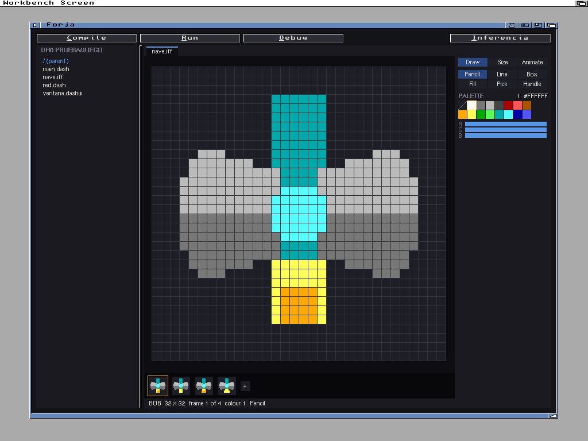
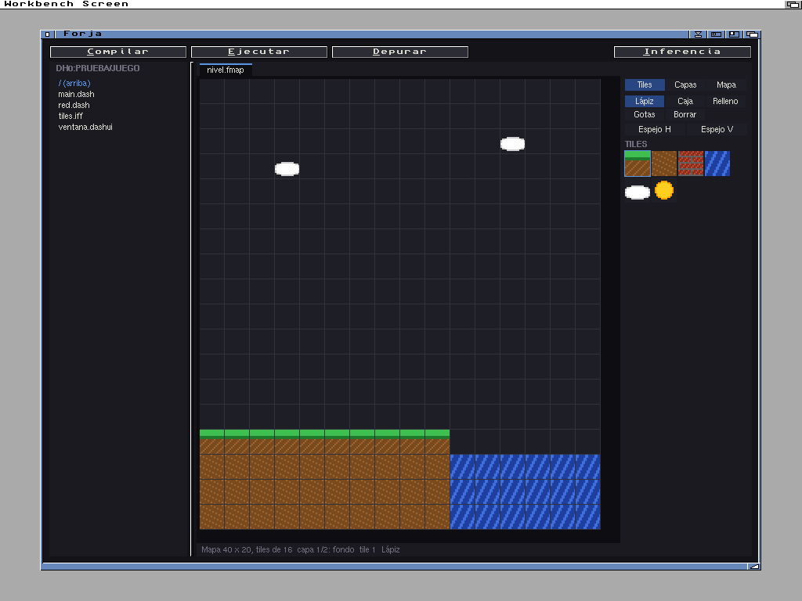

# Forja

*English | [Castellano](README.md)*

A development environment for [Dash](https://github.com/FreeMEM/FreeMEMLang) that runs on the Amiga itself, with a
black background: code editor with colours, build and run, step-by-step debugger and a `.dashui` window editor with
real MUI. It talks over ARexx with [Inferencia](https://github.com/FreeMEM/inferencia), the AI for the Amiga.

This is a test version: it works in the emulator, but it has not been tried on a real Amiga yet. It speaks
English or Spanish, following the Locale preferences (the English catalog is in `Catalogs/`).

## Requirements

- AmigaOS 3.0 or later, with a 68020 or better, and MUI 3.8 or 5.
- Dash 2.3.1 or later for the Amiga: the `dash-X.Y.Z-amiga.lha` package from
  [Dash](https://github.com/FreeMEM/dash/releases) has the `dash` command and also Forja and dashgit, and its installer sets
  everything up. Forja looks for the compiler in `ENV:Forja/dashc` (in the preferences, with a button to choose it),
  then `DASH:dash`, then as `dash` in the command path.
- For the Inferencia button, [Inferencia](https://github.com/FreeMEM/inferencia) (`ENV:Forja/inferencia`).
- For the Git menu, [dashgit](https://github.com/FreeMEM/dashgit): Forja looks for it in `ENV:Forja/dashgit`, then
  `DASH:dashgit`, then as `dashgit` in the command path. To pull and push over https, AmiSSL and a TCP/IP stack.
- Syntax colours look better with more than 4 colours on the screen.

## Use

`Forja [file]`, or double-click its icon. Without a file, it opens what was open last time (this can be turned off
in the preferences).

The preferences can also make Forja start on a screen of its own: a public copy of the Workbench's, named `FORJA`.
While Forja is open it is the default public screen, so the programs it runs open there. On quitting, the old
default comes back. It needs a Dash with `screen_make_default`.

When compiling, the executable goes next to the `.dash`. In the preferences, "Executables in:" picks another drawer
(an idea of Ferrán García), for example `RAM:` (`ENV:Forja/ejecutables`); if it does not exist, Forja creates it. The program runs in the
`.dash`'s drawer, so it finds its files with a relative path (`"jugador.iff"`) even when the executable is elsewhere.
What it looks for in `PROGDIR:` (its icon, its catalogs) it will look for in the executable's drawer.

- **Editor**: the keyboard goes to the editor when the pointer is over it. Arrows; with Shift they select; Alt: start
  and end of line, page up and down; Ctrl: word by word, start and end of the text. Tab and Shift+Tab indent;
  pressing Return after `func`, `if`, `while` and the like indents the new line one level, and `end`, `else` and
  `elif` go back to their place by themselves, as in the VS Code extension. Undo (Amiga-Z), redo (Amiga-R), cut, copy
  and paste with the system clipboard.
- **Files**: tabs; Amiga-N, Amiga-O, Amiga-S, Amiga-W. The left panel opens the files of the drawer with a click (folders first, in order); the
  wheel and its scroll bar move it. It asks when closing with unsaved changes.
- **Find and replace** (Amiga-F) and **go to line** (Amiga-L).
- **Completion**: after two letters a list appears under the cursor with Dash's words, its builtins and the
  project's names (functions, structs, constants, global variables and the function's locals; also those of the
  files it imports). After a dot, the struct's fields and methods, or what lists and strings have. Arrows choose,
  Tab or Return insert, Esc closes; Ctrl+Space shows it with fewer letters. Typing "(" after a function or a builtin
  shows its arguments and description. It can be turned off in Preferences. Help or F1 show that help for the name
  under the cursor (idea by Javier R. Santurde "Tolkien").
- **Go to definition** (Amiga-J or Ctrl+click): to the file and line where the name is defined, opening it if
  needed; Amiga-U goes back. **Find uses** (Amiga-H): the list in the output, and a click goes to each place. The
  symbols are read when a file is opened or shown and after a moment without typing (in the Code menu).
- **The top bar**: Build, Run, Debug, the debugger buttons and Inferencia, each with a coloured icon and its name.
  The ones that do nothing right now are grey, and the one under the pointer lights up. In a narrow window, first
  the grey ones and then all of them show only their icon.
- **Build** (Amiga-K) and **run** (Amiga-E): errors show at the bottom, and a click takes you to the line. The
  output keeps everything written to it: the wheel and its scroll bar go back up. A click picks a line (dragging,
  several) and Amiga-C copies it; the Program menu has "Copy the output" and "Save the output...".
  In a project of several files, compiling or running from one without `Main` uses the project's program. An error
  of the program while it runs is shown in red, and a click goes to its line. **Stop** ends a program stuck in a
  loop (it needs Dash 2.11.0); if it has a window and does not stop, Forja tells you to close it. Quitting with
  something running stops it first.
- **Debug** (Amiga-G or F5): breakpoints with F9 or a click in the margin; F5 continue, F10 step over, F6 step into,
  F7 step out, with the pointer anywhere in the window, unless a text field or another gadget has the keyboard
  (reported by David Martínez). On the left, the call stack and the
  variables. When it stops, Forja comes to the front: the program's window takes the keyboard when it opens. If the
  stop line is already in view, the code does not move or repaint as a whole, nor jumps when clicking on it or on the variables (reported by
  David Martínez).
- **`.dashui` windows** open in the window editor (Amiga-D switches to text). The object tree and its properties;
  "+" adds, Del removes, Alt+arrows moves. Amiga-P opens the preview with real MUI. It saves the same way as the VS
  Code extension.
- **Inferencia** (Amiga-I): sends it the file, or the selected lines.
- **Sprites and BOBs**: IFF ILBM pictures (DPaint brushes too) open in their own editor, and Amiga-B makes a
  hardware sprite (16 wide, 3 colours and the transparent one) or a BOB (any size and colours). They are saved as
  IFF, and Dash's `sprite_load` and `bob_load` load them as they are.
  - Drawing: P pencil, L line, B box (filled with Shift when you start), F fill, K eyedropper, A handle point.
    Alt + click erases; Ctrl + click picks the colour. Up, down and the digits choose a colour; the R G B bars
    change it.
  - Frames: the arrows go from one to another, N new, D duplicate, Del remove, Backspace clear, H and V mirror,
    Alt + arrows move, Shift + arrows scroll the drawing, Amiga-C/X/V copy, cut and paste. O turns the onion skin
    on.
  - Animation: Space starts the animated preview; + and - change the speed.
  - Size: Ctrl + arrows, or the Size tab (width, height, colours); T turns a hardware sprite into a BOB.
  - C copies to the clipboard the Dash lines that load it, with its colours and how to animate it.

  
- **New Dash versions**: Project > Look for a new version of Dash looks on GitHub and, if there is one, asks whether
  to download it and install it in the Dash drawer (`DASH:`): the dash command, Forja, Inferencia, `lib/` and the
  examples. It checks everything before changing anything; if something arrives damaged, Dash stays as it was. At
  startup it looks once a day and only tells you in the output (it can be turned off in the preferences). It needs
  the network and AmiSSL. Also through ARexx: `ACTUALIZAR`.
- **Tile maps**: `.fmap` files (IFF `FORM FMAP`) open in the map editor, and Amiga-B also makes a new map. The
  tileset is a BOB from the sprite editor, with one frame a tile of 8, 16 or 32; the map keeps its name. Dash's
  `tilemap_load` and `tilemap_draw` load and draw them.
  - Tools: P pencil, B box, F fill, K pick, E erase. Alt + click erases; Ctrl + click picks the tile. H and V
    mirror the tile; comma and full stop change the tile. In the panel, the Tiles page chooses the tile.
  - Layers (Layers page): choose, show or hide, new, remove, back and front. Map (Map page): width, height, zoom,
    grid (G) and tileset.
  - The arrows and the wheel move the view (with Shift, a screen at a time); + and - change the zoom.
  - Collisions: on the Layers page a layer becomes a collision layer; on it you paint solid, platform, ladder or
    harm, shown on top as a pattern of colours. The game reads it with `tilemap_get`.
  - Objects (Objects page): a click puts one of the chosen kind (player, enemy, coin, door, other) or chooses the
    one there; dragging moves it and Del removes it. They can have a sprite. The game finds them with
    `tilemap_object_find`.
  - Amiga-Z and Amiga-R undo and redo; C copies the Dash lines that load and draw it.

  

### Git

The Git menu runs [dashgit](https://github.com/FreeMEM/dashgit) in the project drawer. **dashgit is in alpha**:
there is still a lot to test, so keep a copy of what matters. The menu has status, differences, history,
add the new files, commit the changes (it asks for the message), pull (which merges if needed) and push. It saves
what is unsaved first, and what dashgit writes goes to the output. The `.git` drawer is hidden in the project panel.

### ARexx

Port `FORJA.1`: `ABRIR file [line]` (open), `ABIERTO file` (is it open), `TEXTO file` (text), `SELECCION`
(selection), `CAMBIAR file from to text` (change lines), `GUARDAR [file]` (save), `COMPILAR` (build), `EJECUTAR`
(run), `ESTADO` (state), `ERRORES` (errors), `BUSCAR text` (find), `CAMBIARTODO find replace`, `IRA line` (go to),
`GIT dashgit command` (without waiting: `ESTADO` says `git` while it runs) and `SALIDA` (the output text).

## Build

With Dash 2.3.1: `./dash src/main.dash -o Forja`. The package: `python3 tools/paquete.py 0.3`. The tests run in the
emulator: [tests/LEEME.md](tests/LEEME.md) (in Spanish).

Written in Dash. MIT license.
