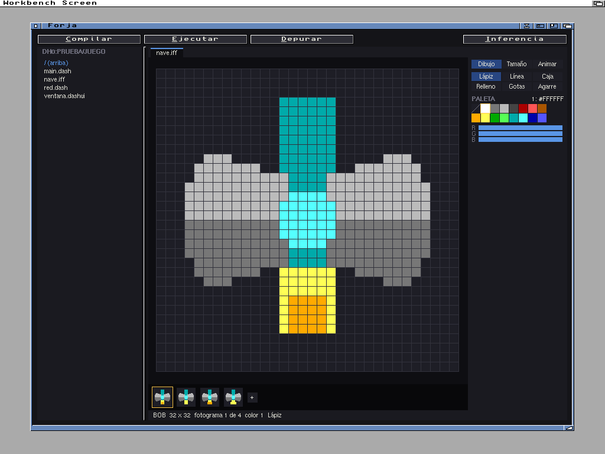
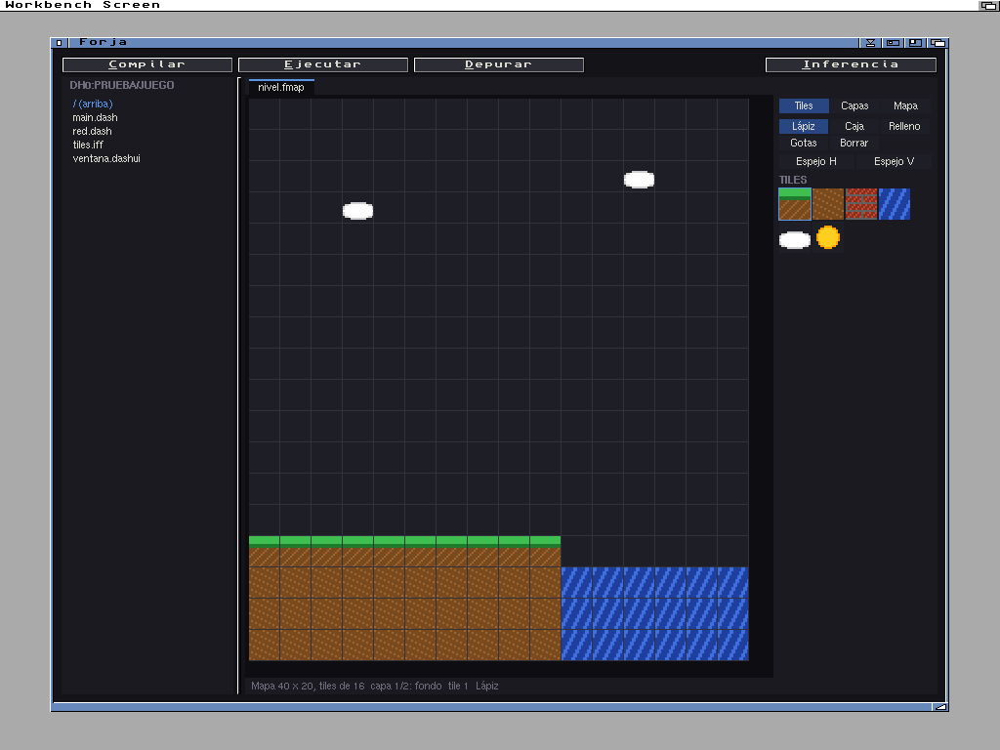

# Forja

*[English](README.en.md) | Castellano*

Un entorno de desarrollo para [Dash](https://github.com/FreeMEM/FreeMEMLang) que corre en el propio Amiga, con
fondo negro: editor con colores, compilar y ejecutar, depurador paso a paso y editor de ventanas `.dashui` con MUI
de verdad. Se entiende por ARexx con [Inferencia](https://github.com/FreeMEM/inferencia), la IA para el Amiga.

Es una versión de prueba: funciona en el emulador, pero aún no se ha probado en un Amiga de verdad. Habla en
castellano o en inglés, según el idioma de las Preferencias de Locale (el catálogo inglés va en `Catalogs/`).

## Qué necesita

- AmigaOS 3.0 o mejor, con un 68020 o mejor, y MUI 3.8 o 5.
- Dash 2.3.1 o posterior para el Amiga: el paquete `dash-X.Y.Z-amiga.lha` de
  [Dash](https://github.com/FreeMEM/dash/releases) trae la orden `dash` y también Forja y dashgit, y su instalador lo deja
  todo listo. Forja busca el compilador en `ENV:Forja/dashc` (en Preferencias, con un botón para elegirlo), si no en
  `DASH:dash` y si no como `dash` en el camino de órdenes.
- Para el botón Inferencia, [Inferencia](https://github.com/FreeMEM/inferencia) (`ENV:Forja/inferencia`).
- Para el menú Git, [dashgit](https://github.com/FreeMEM/dashgit): Forja lo busca en `ENV:Forja/dashgit`, si no en
  `DASH:dashgit` y si no como `dashgit` en el camino de órdenes. Para traer y subir por https, AmiSSL y una pila TCP/IP.
- Los colores de la sintaxis se ven mejor con más de 4 colores en la pantalla.

## Uso

`Forja [fichero]`, o un doble clic en su icono. Sin fichero, abre lo de la última vez (se puede quitar en
Preferencias).

En Preferencias también se puede pedir que Forja arranque en su propia pantalla: una copia de la del Workbench,
pública, llamada `FORJA`. Mientras Forja está abierto, es la pantalla pública por defecto, así que los programas que
ejecuta salen ahí. Al salir, vuelve a serlo la de antes. Necesita un Dash con `screen_make_default`.

Al compilar, el ejecutable se deja al lado del `.dash`. En Preferencias, "Ejecutables en:" elige otro cajón (idea de Ferrán
García), por ejemplo `RAM:` (`ENV:Forja/ejecutables`); si no existe, Forja lo crea. El programa se ejecuta en el cajón del `.dash`,
así que encuentra sus ficheros con ruta relativa (`"jugador.iff"`) aunque el ejecutable esté en otro cajón. Lo que
busque en `PROGDIR:` (su icono, sus catálogos) lo buscará en el cajón del ejecutable.

- **Editor**: el teclado va al editor con el puntero encima. Flechas; con Mayúsculas eligen; Alt: principio y final
  de línea, página arriba y abajo; Ctrl: de palabra en palabra, principio y final del texto. Tab y Mayúsculas+Tab
  sangran. Deshacer (Amiga-Z), rehacer (Amiga-R), cortar, copiar y pegar con el portapapeles del sistema.
- **Ficheros**: pestañas; Amiga-N, Amiga-O, Amiga-S, Amiga-W. El panel de la izquierda abre los ficheros del cajón
  con un clic; la rueda y su barra lo mueven. Al cerrar con cambios, pregunta.
- **Buscar y cambiar** (Amiga-F) e **ir a la línea** (Amiga-L).
- **Completar**: a partir de dos letras sale una lista bajo el cursor con las palabras de Dash, sus builtins y los
  nombres del proyecto (funciones, structs, constantes, variables globales y las locales de la función; también los
  de lo que importa el fichero). Tras un punto, los campos y métodos del struct, o lo que tienen las listas y los
  textos. Flechas para elegir, Tab o Return la meten, Esc la cierra; Ctrl+Espacio la saca con menos letras. Al
  escribir "(" tras una función o un builtin, una ayuda con sus argumentos y su descripción. Se apaga en
  Preferencias. Help o F1 sacan esa ayuda para el nombre que hay en el cursor (idea de Javier R. Santurde "Tolkien").
- **Ir a la definición** (Amiga-J o Ctrl+clic): al fichero y la línea donde se define el nombre, abriéndolo si hace
  falta; Amiga-U vuelve. **Dónde se usa** (Amiga-H): la lista en la salida, y un clic lleva a cada sitio. Los
  símbolos se leen al abrir o cambiar de fichero y tras un momento sin escribir (en el menú Código).
- **Compilar** (Amiga-K) y **ejecutar** (Amiga-E): los errores salen abajo, y un clic lleva a su línea. La salida
  guarda todo lo que se ha escrito: la rueda y su barra suben a verlo. Un clic elige una línea (arrastrando, varias) y
  Amiga-C la copia; en el menú Programa, "Copiar la salida" y "Guardar la salida...".
- **Depurar** (Amiga-G o F5): puntos de parada con F9 o un clic en el margen; F5 seguir, F10 paso, F6 entrar, F7
  salir, con el puntero en cualquier sitio de la ventana, salvo si un campo de texto u otro gadget tiene el teclado
  (lo contó David Martínez). A la izquierda, la pila y las variables. Al parar,
  Forja se pone delante: la ventana del programa se queda el teclado al abrirse. Si la línea de la parada ya se ve,
  el código no se mueve ni se repinta entero (lo contó David Martínez).
- **Ventanas `.dashui`**: se abren en el editor de ventanas (Amiga-D cambia a texto). El árbol de objetos y sus
  propiedades; "+" añade, Supr quita, Alt+flechas mueve. Amiga-P abre la vista previa con MUI de verdad. Se guarda
  igual que la extensión de VS Code.
- **Inferencia** (Amiga-I): le manda el fichero, o las líneas elegidas.
- **Sprites y BOBs**: las imágenes IFF ILBM (también los pinceles de DPaint) se abren en su propio editor, y
  Amiga-B crea un sprite de hardware (16 de ancho, 3 colores y el transparente) o un BOB (del tamaño y los
  colores que quieras). Se guardan como IFF, y `sprite_load` y `bob_load` de Dash los cargan tal cual.
  - Dibujar: P lápiz, L línea, B caja (con Mayúsculas al empezar, rellena), F relleno, K cuentagotas, A punto
    de agarre. Alt + clic borra; Ctrl + clic coge el color. Arriba, abajo y las cifras eligen color; las barras
    R G B lo cambian.
  - Fotogramas: flechas para ir de uno a otro, N nuevo, D duplicar, Supr quitar, Retroceso vaciar, H y V espejo,
    Alt + flechas mover, Mayúsculas + flechas desplazar el dibujo, Amiga-C/X/V copiar, cortar y pegar. O enciende
    la piel de cebolla.
  - Animar: Espacio pone en marcha la vista animada; + y - cambian la velocidad.
  - Tamaño: Ctrl + flechas, o la pestaña Tamaño (ancho, alto, colores); T pasa de sprite de hardware a BOB.
  - C copia al portapapeles las líneas de Dash que lo cargan, con sus colores y cómo animarlo.

  
- **Versiones nuevas de Dash**: Proyecto > Buscar versión nueva de Dash la busca en GitHub y, si la hay, pregunta si
  la baja e instala en el cajón de Dash (`DASH:`): la orden dash, Forja, Inferencia, `lib/` y los ejemplos. Antes de
  cambiar nada lo comprueba todo; si algo llega mal, Dash se queda como estaba. Al empezar mira una vez al día y solo
  avisa en la salida (se apaga en las preferencias). Hace falta la red y AmiSSL. También por ARexx: `ACTUALIZAR`.
- **Mapas de tiles**: los ficheros `.fmap` (IFF `FORM FMAP`) se abren en el editor de mapas, y Amiga-B también
  crea un mapa nuevo. El tileset es un BOB del editor de sprites, con un fotograma por tile de 8, 16 o 32; el mapa
  guarda su nombre. `tilemap_load` y `tilemap_draw` de Dash los cargan y los pintan.
  - Herramientas: P lápiz, B caja, F relleno, K cuentagotas, E borrar. Alt + clic borra; Ctrl + clic coge el tile.
    H y V ponen el tile en espejo; la coma y el punto cambian de tile. En el panel, la página Tiles elige el tile.
  - Capas (página Capas): elegir, ver u ocultar, nueva, quitar, atrás y delante. Mapa (página Mapa): ancho, alto,
    zoom, rejilla (G) y tileset.
  - Las flechas y la rueda mueven la vista (con Mayúsculas, de pantalla en pantalla); + y - cambian el zoom.
  - Choques: en la página Capas, una capa pasa a ser de choques; en ella se pinta sólido, plataforma, escalera o
    daño, que se ven encima como una trama de colores. El juego lo lee con `tilemap_get`.
  - Objetos (página Objetos): un clic pone uno de la clase elegida (jugador, enemigo, moneda, puerta, otro) o elige
    el que hay; arrastrando se mueve y Supr lo quita. Pueden llevar un sprite. El juego los busca con
    `tilemap_object_find`.
  - Amiga-Z y Amiga-R deshacen y rehacen; C copia las líneas de Dash que lo cargan y lo pintan.

  

### Git

El menú Git usa [dashgit](https://github.com/FreeMEM/dashgit) en el cajón del proyecto. **dashgit está en alfa**:
aún hay mucho que probar, así que ten copia de lo importante. El menú tiene estado, diferencias,
historial, añadir los ficheros nuevos, confirmar los cambios (pide el mensaje), traer del servidor (pull, que
fusiona si hace falta) y subir (push). Antes guarda lo que haya sin guardar, y lo que escribe dashgit sale en la salida.
El cajón `.git` no se ve en el panel del proyecto.

### ARexx

Puerto `FORJA.1`: `ABRIR fichero [línea]`, `ABIERTO fichero`, `TEXTO fichero`, `SELECCION`,
`CAMBIAR fichero desde hasta texto`, `GUARDAR [fichero]`, `COMPILAR`, `EJECUTAR`, `ESTADO`, `ERRORES`,
`BUSCAR texto`, `CAMBIARTODO buscar cambiar`, `IRA línea`, `GIT orden de dashgit` (sin esperar: `ESTADO` da `git`
mientras sigue) y `SALIDA` (el texto de la salida).

## Compilar

Con Dash 2.3.1: `./dash src/main.dash -o Forja`. El paquete: `python3 tools/paquete.py 0.3`. Las pruebas, en el
emulador: [tests/LEEME.md](tests/LEEME.md).

Escrito en Dash. Licencia MIT.
