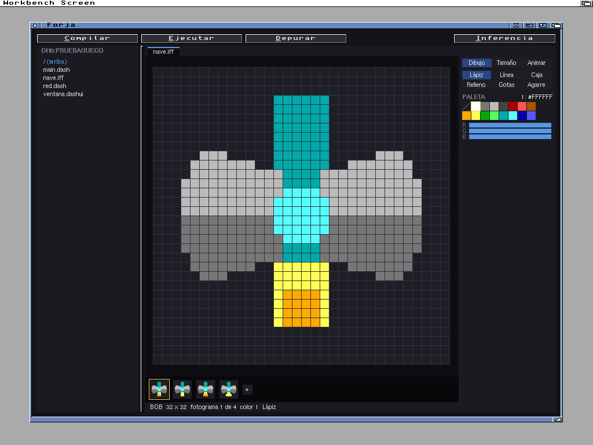
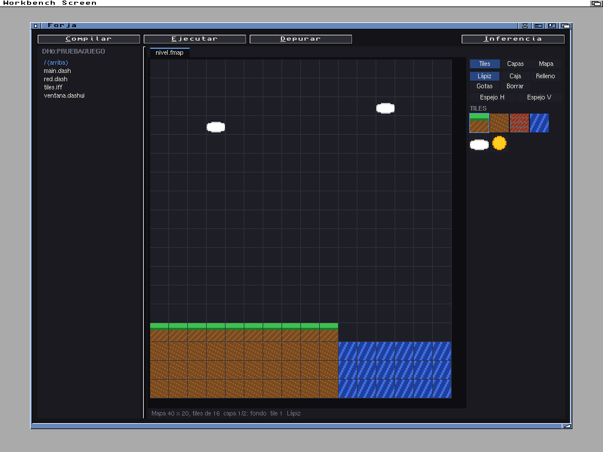

# Forja

*[English](README.en.md) | Castellano*

Forja es el entorno de desarrollo de [Dash](https://github.com/FreeMEM/FreeMEMLang) para el propio Amiga. Esto es
Forja 0.7:

- un editor con colores, pestañas, marcadores, plegado, buscar en el proyecto y renombrar;
- compilar y ejecutar, con los errores marcados en el código;
- un depurador paso a paso, con condiciones y variables en árbol;
- proyectos (un fichero `.forja`) y seis plantillas;
- la ayuda de Dash entera, con ejemplos que se ejecutan;
- un editor de ventanas `.dashui` con MUI de verdad;
- extensiones: Git, el copiloto de [Inferencia](https://github.com/FreeMEM/inferencia), Sprites, Mapas y Demos.

Es una versión de prueba. Funciona en el emulador, pero aún no se ha probado en un Amiga de verdad. Habla en
castellano o en inglés, según el idioma de las Preferencias de Locale (el catálogo inglés va en `Catalogs/`).

## Qué necesita

- AmigaOS 3.0 o mejor, con un 68020 o mejor, y MUI 3.8 o 5.
- Dash 2.16.0 o posterior para el Amiga: el paquete `dash-X.Y.Z-amiga.lha` de
  [Dash](https://github.com/FreeMEM/dash/releases) trae la orden `dash` y también Forja y dashgit, y su instalador lo deja
  todo listo. Forja busca el compilador en `ENV:Forja/dashc` (en Preferencias, con un botón para elegirlo), si no en
  `DASH:dash` y si no como `dash` en el camino de órdenes.
- Para el copiloto (la extensión Inferencia), [Inferencia](https://github.com/FreeMEM/inferencia) (`ENV:Forja/inferencia`).
- Para git (la extensión Git), [dashgit](https://github.com/FreeMEM/dashgit) con su orden `servidor`: se busca en
  `ENV:Forja/dashgit`, si no en `DASH:dashgit` y si no como `dashgit` en el camino de órdenes. Para traer y subir por
  https, AmiSSL y una pila TCP/IP.
- Los colores de la sintaxis se ven mejor con más de 4 colores en la pantalla.

## Uso

`Forja [fichero]`, o un doble clic en su icono. Sin fichero, abre lo de la última vez (se puede quitar en
Preferencias): los ficheros con su cursor, sus marcadores y lo plegado, el de delante, y los sprites, mapas y pistas
que tenían abiertos las extensiones.

En Preferencias también se puede pedir que Forja arranque en su propia pantalla: una copia de la del Workbench,
pública, llamada `FORJA`. Mientras Forja está abierto, es la pantalla pública por defecto, así que los programas que
ejecuta salen ahí. Al salir, vuelve a serlo la de antes. Necesita un Dash con `screen_make_default`.

Al compilar, el ejecutable se deja al lado del `.dash`. En Preferencias, "Ejecutables en:" elige otro cajón (idea de Ferrán
García), por ejemplo `RAM:` (`ENV:Forja/ejecutables`); si no existe, Forja lo crea. El programa se ejecuta en el cajón del `.dash`,
así que encuentra sus ficheros con ruta relativa (`"jugador.iff"`) aunque el ejecutable esté en otro cajón. Lo que
busque en `PROGDIR:` (su icono, sus catálogos) lo buscará en el cajón del ejecutable.

- **Editor**: el teclado va al editor aunque el puntero esté en el proyecto, la salida o la barra de botones.
  Flechas; con Mayúsculas eligen; Alt: principio y final de línea, página arriba y abajo; Ctrl: de palabra en palabra,
  principio y final del texto. Tab y Mayúsculas+Tab sangran; al pulsar Return tras `func`, `if`, `while` y demás, la
  línea nueva entra un nivel y, si el bloque no tiene su `end`, lo pone debajo; `end`, `else` y `elif` vuelven solos a
  su sitio, como en la extensión de VS Code. Paréntesis, corchetes, llaves y comillas se cierran solos (escribir el
  que cierra pasa por encima; Retroceso entre los dos los quita). Las dos cosas se apagan en el menú Editor.
  Deshacer (Amiga-Z), rehacer (Amiga-R), cortar, copiar y pegar con el portapapeles del sistema.
- **Colores**: los de la gramática de Dash (las palabras salen de Dash con `tools/sintaxis.py`, no se escriben a
  mano), también las directivas (`@native`...) y los bloques `asm ... end` con los suyos: instrucciones, registros y
  etiquetas.
- **Menú Editor** (las teclas, por defecto; se cambian en `ENVARC:Forja/teclas`):

  | Orden | Tecla |
  |---|---|
  | Comentar o descomentar (la línea o la selección; en un bloque asm, con `;`) | Ctrl / |
  | Duplicar, subir, bajar y borrar las líneas | Ctrl D, Ctrl Alt arriba, Ctrl Alt abajo, Ctrl Mayús K |
  | Ir a la pareja (el paréntesis, o el `end` de un `func`, `if`, `asm`...; con el cursor encima, los dos se ven en un recuadro) | Ctrl M |
  | Poner o quitar marcador, siguiente, anterior | Ctrl F3, F3, Mayús F3 |
  | Esquema del fichero (funciones, structs, constantes...: se filtra escribiendo) | Ctrl O |
  | Abrir un fichero del proyecto por su nombre | Ctrl P |
  | Ir a un nombre de todo el proyecto | Ctrl T |
  | Buscar en el proyecto (lo del cursor; resultados con clic en la salida) | Ctrl Mayús F |
  | Cambiar en el proyecto (antes, la lista de cambios) | Ctrl Mayús H |
  | Renombrar en todo el proyecto (antes, la lista de cambios) | F2 |
  | Plegar o desplegar el bloque del cursor; desplegar todo | F4; Mayús F4 |
  | Pestaña siguiente, anterior y la lista de todas | Ctrl Tab, Ctrl Mayús Tab, Ctrl E |

  F8 sigue siendo el siguiente error. `ENVARC:Forja/teclas` lleva una orden por línea, `orden = teclas`: por ejemplo
  `duplicar = alt d` o `comentar = nada`. Las órdenes: comentar, duplicar, subir, bajar, borrar_linea, pareja,
  marcador, marcador_siguiente, marcador_anterior, esquema, abrir_fichero, abrir_simbolo, buscar_proyecto,
  cambiar_proyecto, renombrar, plegar, desplegar_todo, pestana_siguiente, pestana_anterior, pestanas. Las letras van por su sitio en un teclado inglés (como las de
  las extensiones); un signo (`/`) va por el carácter. Lo que no se entiende se dice en la salida. Si el fichero
  cambia con Forja abierta, lo lee otra vez y el menú Editor enseña las teclas nuevas.
- **Tema**: `ENVARC:Forja/tema` cambia los colores (`comentario = 120 120 136`: fondo, texto, tenue, acento, error,
  seleccion, cursor..., y los de la sintaxis: clave, tipo, cadena, numero, comentario, llamada, constante, directiva,
  asm_instruccion, asm_registro, asm_etiqueta) y la fuente del código (`fuente = xen.font 8`, de letras igual de
  anchas).
- **Ficheros**: Amiga-N, Amiga-O, Amiga-S, Amiga-W. El panel de la izquierda abre los ficheros del cajón con un
  clic, carpetas primero y en orden; la rueda y su barra lo mueven. Al cerrar con cambios, pregunta.
- **Pestañas**: una por fichero. Si dos ficheros se llaman igual, llevan delante su cajón (`Cueva/main.dash`). Ctrl
  Tab va a la siguiente y Ctrl Mayús Tab a la anterior. Si no caben, la de delante siempre se ve y a la derecha salen
  tres botones: las flechas mueven las pestañas y el triángulo abre la lista de todas. Esa lista también sale con
  Ctrl E; se filtra escribiendo y Return va a la elegida. La rueda sobre las pestañas también las mueve.
- **Buscar y cambiar** (Amiga-F) e **ir a la línea** (Amiga-L). Con "Expresión regular", lo buscado es una
  expresión regular (las de `regex_find` de Dash), y en "Cambiar por", `$1` a `$9` son sus grupos. "Buscar en el
  proyecto" y "Cambiar en el proyecto" lo hacen en todos los `.dash` y `.dashui` del cajón del proyecto y los de
  dentro (con el texto sin guardar de los abiertos). Antes de cambiar nada, sale la pestaña Cambios: cada línea como
  está y como quedará. Se queda abierta para mirarla entera, también yendo a otras pestañas. En ella, Return hace los
  cambios y Esc no. Si los ficheros cambian entretanto, no se hace nada y lo dice. Los ficheros abiertos cambian en
  el editor (se deshace con Amiga-Z); los demás, en el disco. Renombrar (F2) va igual.
- **Completar**: a partir de dos letras sale una lista bajo el cursor con las palabras de Dash, sus builtins y los
  nombres del proyecto (funciones, structs, constantes, variables globales y las locales de la función; también los
  de lo que importa el fichero). Tras un punto, los campos y métodos del struct, o lo que tienen las listas y los
  textos. Flechas para elegir, Tab o Return la meten, Esc la cierra; Ctrl+Espacio la saca con menos letras. Al
  escribir "(" tras una función o un builtin, una ayuda con sus argumentos y su descripción. Se apaga en
  Preferencias. Help o F1 sacan esa ayuda para el nombre que hay en el cursor (idea de Javier R. Santurde "Tolkien").
- **Ayuda de Dash**: Help o F1 sobre una función o una palabra del lenguaje abre su ficha entera en la ventana de la
  ayuda: la firma, los parámetros, qué hace, un ejemplo con colores, "ver también" y si está en DashOS. Un clic en un
  enlace (o en un nombre del ejemplo) lleva a su ficha; Atrás y Adelante (o Retroceso, Alt+flechas) recorren lo
  visto. "Buscar:" encuentra palabras en toda la ayuda (también por cómo empiezan: "fich"), e Índice enseña los grupos
  de funciones y los capítulos del manual. **Probar** abre el ejemplo de la ficha en una pestaña nueva sin nombre y lo
  ejecuta. En el menú Código: "Ayuda de Dash" y "Buscar en la ayuda...". Sobre un nombre del proyecto, F1 sigue
  sacando la ayuda de sus argumentos. La ayuda es la que trae el paquete de Dash (`Dash/Ayuda/Dash.ayuda`, en inglés
  `Dash_en.ayuda`, según el idioma de Forja); se lee a trozos, sin cargarla entera. Se busca en `ENV:Forja/ayuda` (un
  cajón), `DASH:Ayuda`, el cajón `Ayuda` de encima del de Forja y el que está junto al compilador.
- **Errores en el código**: al guardar, Forja comprueba el programa con `dash --check` en segundo plano (sin frenar
  el editor) y marca el error en su línea: el número en rojo y el texto subrayado; la barra de la salida dice cuál es y
  la salida lo apunta, con clic. Tras una pausa al escribir (1,5 s) también comprueba lo que hay sin guardar (se apaga
  en Preferencias, "Buscar errores al escribir"). F8 va al siguiente error y Mayúsculas+F8 al anterior. Los errores de
  compilar se marcan igual. Necesita un Dash con `--check` (posterior a la 2.15.0).
- **Ir a la definición** (Amiga-J o Ctrl+clic): al fichero y la línea donde se define el nombre, abriéndolo si hace
  falta; Amiga-U vuelve. **Dónde se usa** (Amiga-H): la lista en la salida, y un clic lleva a cada sitio. Los
  símbolos se leen al abrir o cambiar de fichero y tras un momento sin escribir (en el menú Código).
- **La barra de arriba**: Compilar, Ejecutar, Depurar y los botones del depurador, cada uno con un icono
  de color y su nombre. Los que no valen ahora salen en gris, y el que está bajo el puntero se ilumina. Si la ventana
  es estrecha, primero los grises y luego todos se quedan solo con el icono. A la derecha, las zonas de las
  extensiones (Inferencia, la rama de git).
- **Compilar** (Amiga-K) y **ejecutar** (Amiga-E): los errores salen abajo, y un clic lleva a su línea. La salida
  guarda todo lo que se ha escrito: la rueda y su barra suben a verlo. Un clic elige una línea (arrastrando, varias) y
  Amiga-C la copia; en el menú Programa, "Copiar la salida" y "Guardar la salida...". En un proyecto de varios
  ficheros, compilar o ejecutar desde uno que no tiene `Main` lo hace con el programa del proyecto. Un fichero con su
  propio `Main` dentro de un proyecto (una prueba, una herramienta) se compila y se ejecuta él mismo. Un error del
  programa al ejecutarse sale en rojo, y un clic lleva a su línea. **Parar** acaba un programa que se ha quedado en un
  bucle (necesita Dash 2.11.0); si tiene ventana y no para, Forja avisa de que la cierres. Al salir con algo en
  marcha, lo para antes.
- **Depurar** (Amiga-G o F5): puntos de parada con F9 o un clic en el margen. Siguen a su línea al escribir, y al
  deshacer vuelven a la suya con su condición. F5 seguir, F10 paso, F6 entrar, F7
  salir, con el puntero en cualquier sitio de la ventana, salvo si un campo de texto u otro gadget tiene el teclado
  (lo contó David Martínez). A la izquierda, la pila y las variables, en árbol: un clic en el triángulo de una lista
  o de un struct lo despliega (un elemento o un campo por línea, con sangría por nivel) y otro lo pliega; lo
  desplegado sigue así entre pasos mientras la variable exista. Una lista enseña 100 elementos y "... N más" trae los
  siguientes. El panel se mueve a lo alto y a lo ancho con sus barras, la rueda (con Mayúsculas, a lo ancho) y las
  flechas (con Mayúsculas, de página en página) (idea de David Martínez). Al parar,
  Forja se pone delante: la ventana del programa se queda el teclado al abrirse. Si la línea de la parada ya se ve,
  el código no se mueve ni se repinta entero, ni salta al hacer clic en él o en las variables (lo contó David
  Martínez).
- **Ventanas `.dashui`**: se abren en el editor de ventanas (Amiga-D cambia a texto). El árbol de objetos y sus
  propiedades; "+" añade, Supr quita, Alt+flechas mueve. Amiga-P abre la vista previa con MUI de verdad. Se guarda
  igual que la extensión de VS Code.
- **Versiones nuevas de Dash**: Proyecto > Buscar versión nueva de Dash la busca en GitHub y, si la hay, pregunta si
  la baja e instala en el cajón de Dash (`DASH:`): la orden dash, Forja, Inferencia, `lib/` y los ejemplos. Antes de
  cambiar nada lo comprueba todo; si algo llega mal, Dash se queda como estaba. Al empezar mira una vez al día y solo
  avisa en la salida (se apaga en las preferencias). Hace falta la red y AmiSSL. También por ARexx: `ACTUALIZAR`.
### Proyectos

Un proyecto es un cajón con un fichero `.forja` (JSON, como un `.dashui`): su nombre, su tipo, el fichero principal,
el ejecutable, las opciones de compilar, los argumentos, la versión, el icono del programa, los puntos de parada y lo
vigilado en el depurador. Sin `.forja`, Forja funciona como antes.

- **Proyecto > Nuevo proyecto...**: el nombre, la plantilla y el cajón donde se hace (se recuerda). Hace el cajón con
  los ficheros de la plantilla, el `.forja` y su icono, y lo abre. Las plantillas, cada una un programa que ya
  compila y arranca:

  | Plantilla | Qué trae |
  |---|---|
  | Orden del Shell | Argumentos, `LINEAS=si` como tipo de herramienta, códigos de salida 5 y 10 |
  | Commodity | En Exchange (Mostrar, Ocultar, Quitar...) y una tecla rápida que abre una ventanita con la hora |
  | Aplicación MUI | La ventana en `ventana.dashui` (se cambia con el editor de ventanas), con su menú |
  | Juego | Su pantalla, un sprite de hardware que se mueve con el joystick o los cursores y un nivel con monedas |
  | Demo | Su pantalla, el bucle de cada imagen, un bloque `asm ... end` que pinta barras de color línea a línea y sus pistas de sincronía (`sync.dash`, `demo.sync`) para la extensión Demos |
  | 3D con MiniGL | Un cubo que gira con `gl_*`; pide una FPU (compila con `--fpu`) y `minigl.library` |

- **Abrir un proyecto**: Proyecto > Abrir proyecto..., Abrir... con un `.forja`, un clic en él en el panel o un doble
  clic en su icono del Workbench (su herramienta es Forja). Al entrar en el panel en un cajón con `.forja`, ese pasa a
  ser el proyecto.
- **Proyecto > Propiedades del proyecto...**: tres páginas. General: nombre, tipo, fichero principal, ejecutable,
  versión (cambiarla pone al día la línea `@version` del programa) e icono del programa (se copia junto al ejecutable
  al compilar). Compilar: CPU (`--cpu`), FPU (`--fpu`), pila (`--stack`), `--memcheck`, `--profile`, `--gcc` (la orden
  `dash` del Amiga no compila por C: solo sirve con un dash que lo haga), más opciones y el tamaño máximo del ejecutable (para una intro de 4 o 64 KB:
  al compilar, Forja dice lo que pesa y avisa si pasa del tope). Ejecutar: los argumentos al
  ejecutar y al depurar. Sin `.forja`, pregunta si hace uno para el cajón del programa.
- Con proyecto, Compilar y Ejecutar van con su fichero principal, su ejecutable y sus opciones, esté delante el
  fichero que esté. Solo un fichero con su propio `Main` se compila él mismo (con las opciones del proyecto).

### Depurar más

- **Condición y contador** (menú Depurar): la condición del punto de parada de la línea del cursor (`i > 3 and
  nombre == "x"`, una expresión de Dash) y su contador (`3`: desde la tercera vez; `= 3`, `> 3`, `% 2`: cada dos). Un
  punto con algo de eso se dibuja hueco. Se escriben en la pregunta que sale encima del editor (Return acepta, Esc no).
- **Vigilar una expresión**: arriba del panel, en VIGILAR, con su valor en cada parada (una variable con `.campo` y
  `[n]` se despliega como las demás). Otra vez la misma, se quita.
- **El valor bajo el ratón**: parado, con el puntero sobre un nombre del código sale su valor (con lo de delante:
  `naves[i].x`).
- **Cambiar valor...** (menú Depurar): con el programa parado, cambia una variable `Int`, `Char`, `Bool`, `Fixed` o
  `Float` (la del último clic en el panel, también lo vigilado, o la del cursor). Se escribe `nombre = valor`; al
  seguir, el programa usa el nuevo. Un texto, una lista o un struct no se cambian, y lo dice.
- **Ejecutar hasta aquí** (Ctrl F10): sigue hasta la línea del cursor; sin depurar, empieza a depurar y para ahí.
- **Ver los registros** y **Ver la memoria...** (de una dirección o una expresión: `a0`, `$C01000`, `buffer + 16`): en
  el panel, d0-d7, a0-a7 y el PC, y 64 bytes con sus letras.
- Con proyecto, los puntos (con su condición y su contador) y lo vigilado se guardan en el `.forja`.

### Perfil y memcheck

- **Programa > Ejecutar con perfil**: compila con `--profile`, ejecuta y abre la pestaña Perfil: cada función con su
  tiempo propio, el total (con lo que llama) y las llamadas. Un clic en un título ordena por esa columna; un clic (o
  Return) en una función lleva a ella.
- **Programa > Ejecutar con memcheck**: compila con `--memcheck` y ejecuta. Los avisos (un campo de un `nil`, algo
  liberado dos veces...) salen en la salida con su sitio, y un clic lleva a la línea. Al acabar, lo que quedó vivo.

### Sprites y mapas

Los editores de sprites y de mapas son dos extensiones (`Extensiones/Sprites` y `Extensiones/Mapas`): quien solo
programa no los carga. Arrancan al abrir uno de sus ficheros (desde el panel del proyecto, Abrir o la sesión) o al
pedir uno nuevo con Amiga-B, cada una con su ventana y una pestaña por fichero, y acaban al cerrar la última. En su
ventana, Amiga-S guarda (la salida de Forja lo dice y el panel del proyecto lo ve), Amiga-K y Amiga-E compilan y
ejecutan el programa del cajón del sprite (`main.dash`), Ventana > Forja vuelve a Forja y Amiga-Q sale de Forja,
como en su ventana. Al salir de Forja, los que tienen cambios sin guardar cuentan en su pregunta, y los abiertos se
vuelven a abrir la próxima vez con la sesión.

- **Sprites y BOBs** (la extensión Sprites): las imágenes IFF ILBM (también los pinceles de DPaint) se abren en su
  ventana, y Amiga-B (en Forja o en esa ventana) crea un sprite de hardware (16 de ancho, 3 colores y el transparente)
  o un BOB (del tamaño y los colores que quieras). Se guardan como IFF, y `sprite_load` y `bob_load` de Dash los
  cargan tal cual.
  - Dibujar: P lápiz, L línea, B caja (con Mayúsculas al empezar, rellena), F relleno, K cuentagotas, A punto
    de agarre. Alt + clic borra; Ctrl + clic coge el color. Arriba, abajo y las cifras eligen color; las barras
    R G B lo cambian.
  - Fotogramas: flechas para ir de uno a otro, N nuevo, D duplicar, Supr quitar, Retroceso vaciar, H y V espejo,
    Alt + flechas mover, Mayúsculas + flechas desplazar el dibujo, Amiga-C/X/V copiar, cortar y pegar. O enciende
    la piel de cebolla.
  - Animar: Espacio pone en marcha la vista animada; + y - cambian la velocidad.
  - Tamaño: Ctrl + flechas, o la pestaña Tamaño (ancho, alto, colores); T pasa de sprite de hardware a BOB.
  - C copia al portapapeles las líneas de Dash que lo cargan, con sus colores y cómo animarlo.

  
- **Mapas de tiles** (la extensión Mapas): los ficheros `.fmap` (IFF `FORM FMAP`) se abren en su ventana, y
  Amiga-B también crea un mapa nuevo. El tileset es un BOB del editor de sprites, con un fotograma por tile de 8, 16 o 32; el mapa
  guarda su nombre. `tilemap_load` y `tilemap_draw` de Dash los cargan y los pintan.
  - Herramientas: P lápiz, B caja, F relleno, K cuentagotas, E borrar. Alt + clic borra; Ctrl + clic coge el tile.
    H y V ponen el tile en espejo; la coma y el punto cambian de tile. En el panel, la página Tiles elige el tile.
  - Capas (página Capas): elegir, ver u ocultar, nueva, quitar, atrás y delante. Mapa (página Mapa): ancho, alto,
    zoom, rejilla (G) y tileset.
  - Las flechas y la rueda mueven la vista (con Mayúsculas, de pantalla en pantalla); + y - cambian el zoom.
  - Choques: en la página Capas, una capa pasa a ser de choques; en ella se pinta sólido, plataforma, escalera o
    daño, que se ven encima como una trama de colores. El juego lo lee con `tilemap_get`.
  - Objetos (página Objetos): un clic pone uno de la clase elegida (jugador, enemigo, moneda, puerta, otro) o elige
    el que hay; arrastrando se mueve y Supr lo quita. Pueden llevar un sprite. El juego los busca con
    `tilemap_object_find`.
  - Amiga-Z y Amiga-R deshacen y rehacen; C copia las líneas de Dash que lo cargan y lo pintan.

  

### Demos

Las herramientas para hacer demos son una extensión (`Extensiones/Demos`), con su menú Demos y una ventana de cuatro
páginas (Amiga-1 a Amiga-4). Se abre también con un `.sync` o un `.mod` del proyecto. La plantilla Demo ya las usa:
trae `sync.dash` (está también en `Forja/lib`), unas pistas en `demo.sync` y su versión exportada,
`pistas_datos.dash`.

- **Pistas de sincronía**, como Rocket: valores que cambian con la música ("velocidad", "fundido", "escena"), con
  claves en filas de la música (posición × 64 + fila) y, de una a la siguiente, escalón, lineal, suave o rampa. Una
  tabla con una columna por pista: las flechas mueven el cursor (con Mayúsculas, de 16 en 16), las cifras y Return
  ponen una clave, Supr la quita, `i` cambia su tipo y `n` hace una pista; `r` le cambia el nombre, Mayúsculas+Supr la
  quita y Alt+flechas la mueven (también en el menú Pistas). Amiga-Z y Amiga-R deshacen y rehacen. Amiga-S las guarda
  en el `.sync`. La tabla va de página en página, como un tracker: con la demo en marcha solo se repinta lo que cambia.
  - Se pueden tener varios `.sync` abiertos: Tab pasa de uno a otro (Mayúsculas+Tab, al revés), cada uno con su
    cursor y su deshacer. Proyecto > Cerrar estas pistas cierra el de delante. A la demo solo le llegan los cambios
    de su `.sync`.
  - Con la demo en marcha (la que usa `sync.dash` con `VIVO = true`), la extensión se conecta sola: la fila que suena
    se ve en la tabla y en la barra de Forja, Espacio la para y la deja seguir, `g` la lleva a la fila del cursor, `v`
    pone su pantalla delante o detrás de la de Forja, y
    cada clave que se cambia llega a la demo al momento.
  - Amiga-X las exporta a `pistas_datos.dash`: tablas dentro del programa. Con `VIVO = false`, la versión final no
    necesita ni el `.sync` ni Forja.
  - En la demo: `sync_valor("zoom")` (un `Fixed`) o `sync_int("escena")`. El reloj es la música si suena
    (`sync_tocar("musica.mod")`); si no, las imágenes (6 por fila).
  - Cómo hablan, lo más ligero para un 68000: la demo abre el puerto ARexx `DEMOSYNC` y en cada imagen solo mira si
    llegó algo (un `GetMsg` vacío casi siempre); la extensión manda algo solo al cambiar una clave. La fila y las
    líneas las deja la demo en un bloque de memoria, que la extensión lee cinco veces por segundo.
- **Visor de MOD**: los patrones del módulo con la fila que suena resaltada. Espacio lo toca o lo para (con
  `music_*`); izquierda y derecha cambian de posición. Si la demo está en marcha, sigue a la suya. Return mete en el
  código la fila de sincronía (posición × 64 + fila) y `s` lleva el cursor de las pistas allí.
- **Editor de copper**: degradados y cambios de color por línea, con la vista al lado. Unas paradas (una línea y un
  color de 12 bits): flechas o un clic para elegir (en la vista o en la lista); arrastrar en la vista, o Mayúsculas o
  Alt + flechas, para moverla; `r` `g` `b` suben cada color (con
  Mayúsculas, bajan), `n` añade, Supr quita, `d` cambia entre degradado y cambios secos y `c` el registro de color
  (COLOR00 es el fondo). Return lo pone en el fichero de delante: llamadas a `copper_*` o (`t`) una tabla de 256
  colores para un bloque `asm`. Si el bloque ya está, lo cambia allí; `l` lo vuelve a leer del código, y Tab lee el
  bloque siguiente del fichero (con Mayúsculas, el anterior). `p` lo prueba de verdad en una pantalla propia (un clic
  vuelve).
- **Medidor de raster**: cuántas líneas de la pantalla gasta cada imagen de la demo, con las 64 últimas en barras
  (verde hasta media imagen, amarillo hasta tres cuartos, rojo por encima), la media, el máximo y las imágenes
  perdidas. La demo mide entre `sync_fotograma()` (tras `wait_vblank`) y `sync_fin()`. Vale igual para un juego.

### Git

Git es una extensión (`Extensiones/Git`), que usa [dashgit](https://github.com/FreeMEM/dashgit). **dashgit está en
alfa**: aún hay mucho que probar, así que ten copia de lo importante.

- En la barra de botones, a la derecha, la rama y "N cambios"; un clic abre el panel Cambios.
- En el panel del proyecto, una letra en cada fichero o cajón con cambios: M (cambiado), A (nuevo en el índice),
  D (borrado), U (conflicto), ? (sin seguir).
- En el margen del editor, rayas frente al último commit: añadida (raya llena, verde), cambiada (a trozos, azul) y
  quitadas (un triángulo rojo). Siguen a lo que escribes, sin guardar: al meter o quitar líneas se mueven con su
  texto, y tras una pausa sin escribir llegan las de verdad.
- El panel Cambios: una fila por fichero con su casilla (preparado o no para el commit), el mensaje y Confirmar.
  Clic en la casilla, `add` o `reset` de ese fichero; dos clics en el nombre, sus diferencias.
- Las diferencias se abren en una pestaña de solo lectura, con colores: `n` y `p` van al trozo siguiente y al
  anterior, y Return lleva a esa línea del fichero.
- Su menú, Git, en la barra de menús: estado, diferencias, historial, añadir los nuevos, Cambios y confirmar, traer (pull) y
  subir (push). Antes guarda lo que haya sin guardar, y lo que escribe dashgit sale en la salida.

Para que sea rápido, la extensión deja dashgit abierto (`dashgit servidor`) y le pide lo que necesita sin arrancarlo
cada vez. Si ese dashgit no tiene servidor, o deja de contestar, cada orden va en un proceso aparte, más lento.
`SetEnv Forja/git_servidor no` lo apaga.

El cajón `.git` no se ve en el panel del proyecto.

### El copiloto: Inferencia

Inferencia, la IA del Amiga, es también una extensión (`Extensiones/Inferencia`): un programa pequeño, el copiloto,
que lee el código y el proyecto en Forja y se lo pasa a [Inferencia](https://github.com/FreeMEM/inferencia) por
ARexx. Inferencia pone el modelo, la clave y la red (sus preferencias son las de siempre); si no está abierta, el
copiloto la arranca (`ENVARC:Forja/inferencia`: Inferencia > Dónde está Inferencia... lo elige). En la barra de botones,
a la derecha, la zona Inferencia (el botón que antes era de Forja): un clic es "Preguntar sobre esto". Su menú,
Inferencia, en la barra de menús:

- **Preguntar sobre esto** (Amiga-I, o un clic en la zona Inferencia): las líneas elegidas, o el fichero, y la lista del proyecto van a la
  conversación de Inferencia; escribes allí la pregunta.
- **Explicar la selección**: lo elegido, o la función del cursor; la explicación sale en Inferencia.
- **Cambiar el código...** (Ctrl Alt C): dices qué cambiar en lo elegido (o en la función del cursor).
- **Documentar la función**: un comentario encima de la función del cursor.
- **Escribir la prueba**: un programa de prueba para la función del cursor, en un fichero nuevo `prueba_x.dash`. Al
  aceptarla, Forja la ejecuta y lo que dice sale en la salida.
- **Explicar el error** (Ctrl Alt E) y **Arreglar el error** (Ctrl Alt F): el primer error de la última compilación;
  si no la hay, compila antes.
- **Sugerencias al escribir**: apagadas al empezar. Encendidas, al parar al final de una línea Inferencia propone
  cómo sigue, en gris; Tab la mete. Cada una es una petición por la red: con un 68020 y un servidor lejano (o el
  saludo de TLS) tardan segundos, así que son más útiles con un modelo en tu red (Ollama) o un Amiga rápido.

Lo que cambia código no toca nada al llegar: la respuesta sale en una pestaña de solo lectura con las diferencias
(en verde lo que pone, en rojo lo que quita). `a` (o Aceptar el cambio, Ctrl Alt Y) lo aplica, y Amiga-Z lo
deshace; `r` (o Rechazar, Ctrl Alt N) lo descarta. Mientras Inferencia piensa o hay un cambio por aceptar, la barra
de botones lo dice (en la zona Inferencia); un clic cancela lo que se está pidiendo o vuelve a enseñar el cambio. Para estos
encargos, Inferencia lee el fichero, lo que importa y la lista del proyecto, con un tope de 16000 caracteres
(`ENV:Forja/inferencia_tope`), y puede leer otros ficheros y buscar en la ayuda de Dash (`DASH:Ayuda/Dash.ayuda`)
para no inventarse funciones.

### ARexx

Puerto `FORJA.1`: `ABRIR fichero [línea]` (un `.forja` abre el proyecto), `ABIERTO fichero`, `TEXTO fichero`, `SELECCION`,
`CAMBIAR fichero desde hasta texto`, `GUARDAR [fichero]`, `COMPILAR [fichero]`, `EJECUTAR [fichero]`, `ESTADO`, `ERRORES`,
`BUSCAR texto`, `CAMBIARTODO buscar cambiar`, `IRA línea`, `SALIDA` (el texto de la salida), `NUEVOPROYECTO tipo cajón
nombre` (con su plantilla: `orden`, `commodity`, `mui`, `juego`, `demo` o `3d`; da la ruta del `.forja`) y
`PROPIEDAD clave [valor]` (una del `.forja` del proyecto: la da y, con valor, la cambia y la guarda; también `ruta`,
`puntos` y `vigilar`). Para las extensiones
hay más (el cursor, lo elegido, insertar, marcas, rayas, la barra, pestañas propias, por lotes):
[docs/EXTENSIONES.md](docs/EXTENSIONES.md). La extensión Git tiene su puerto, `FORJAEXT.GIT`: `GIT orden de dashgit`
(sin esperar: su `ESTADO` da `git` mientras sigue), `CAMBIOS` y `GITESTADO`.

### Extensiones

Programas aparte en el cajón `Extensiones`, junto a Forja, que añaden opciones al menú Extensiones (o un menú suyo en
la barra), teclas, marcas y rayas en el margen, letras en el proyecto, una zona en la barra de botones, un texto en la
barra, pestañas de solo lectura o un editor para un tipo de fichero con su ventana. Git, el copiloto de Inferencia, Sprites,
Mapas y Demos son extensiones. Hablan con Forja por ARexx;
si una cae o se cuelga, Forja sigue. Extensiones > Gestor de extensiones... las enseña, las activa o las desactiva y
las instala desde un cajón o un `.lha`. La de ejemplo, Contar, cuenta las líneas y las palabras del fichero y mete
la fecha con Ctrl Alt D. Cómo escribir una, con `lib/forja.dash`: [docs/EXTENSIONES.md](docs/EXTENSIONES.md). Cada
una puede llevar su catálogo (`Catalogs/english/X.catalog` en su cajón) y su manifiesto, textos en otro idioma
(`descripcion.english`, `menu.english`).

## Compilar

Con Dash 2.16.0: `./dash src/main.dash -o Forja`. El paquete: `python3 tools/paquete.py 0.7`. Las pruebas, en el
emulador: [tests/LEEME.md](tests/LEEME.md).

Escrito en Dash. Licencia MIT.
